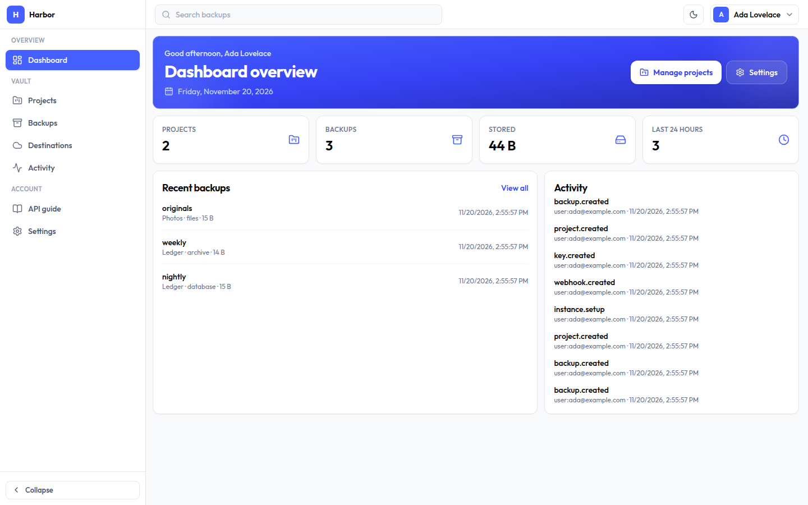
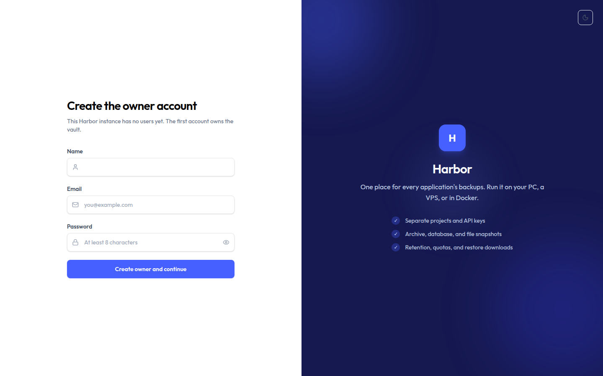
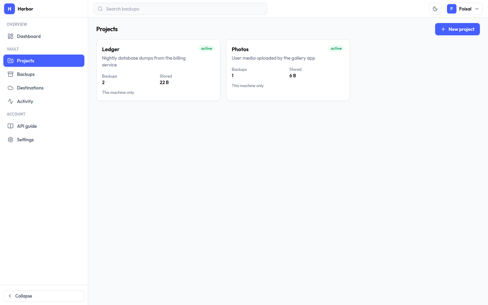
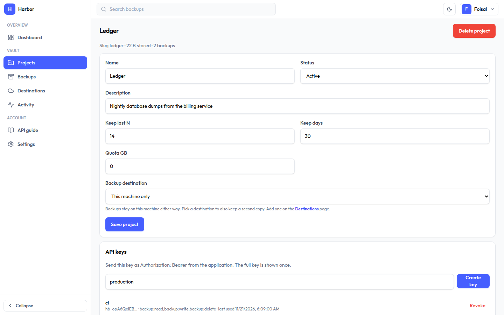
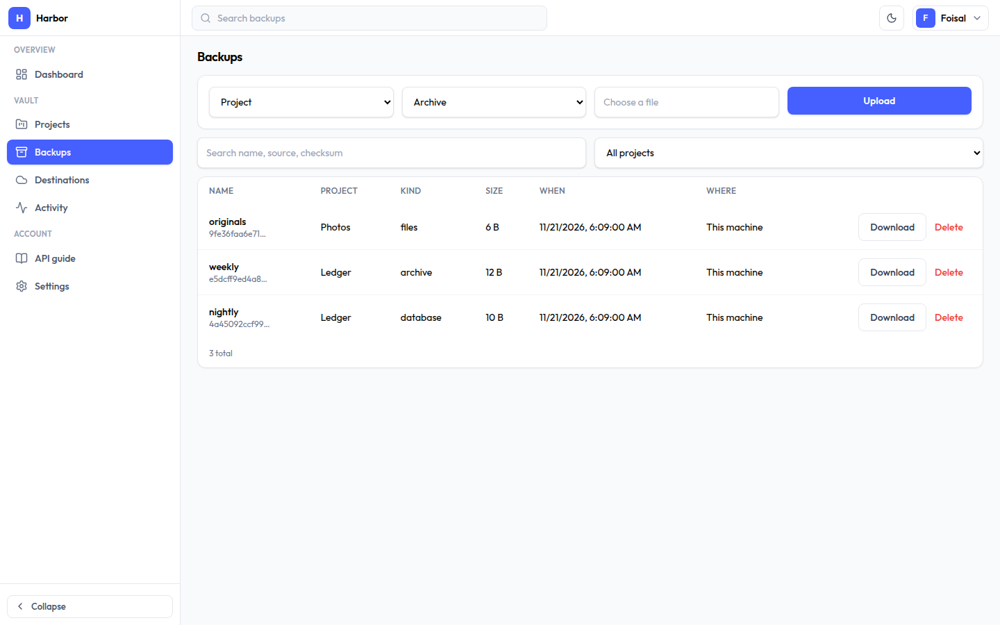
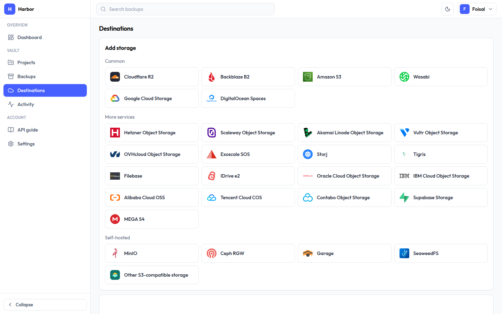
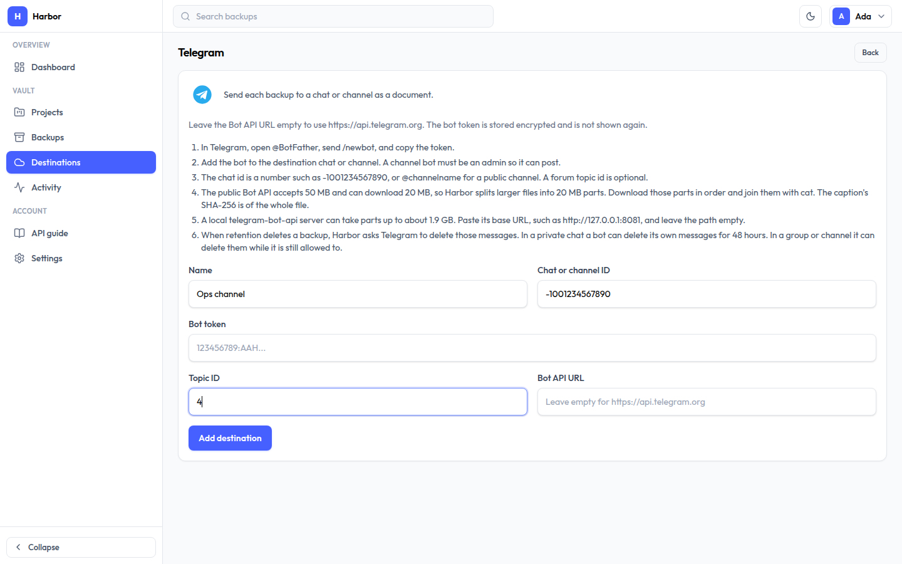

# Harbor

Self-hosted backup vault. One Go process and a SQLite database store archives, database dumps, and files from as many applications as you want.

[](https://github.com/foisalislambd/harbor/actions/workflows/ci.yml)
[](LICENSE)
[](apps/server/go.mod)

The panel is at `/`. The API is at `/api/v1`. Run it on a PC, a VPS, or in Docker. The current release is [v0.2.0](https://github.com/foisalislambd/harbor/releases/tag/v0.2.0) ([VERSION.md](VERSION.md)).



## Features

- Projects with pause, retention (last N and/or N days), and a byte quota. `0` means unlimited. If a create request omits retention, Harbor keeps the last 14 snapshots for 30 days.
- API keys scoped to one project, with `backup:read`, `backup:write`, and `backup:delete`. The secret is shown once.
- Content-addressed blobs, so identical uploads share one file.
- Schedules that turn overdue when a backup does not arrive in time.
- Webhooks for `backup.created` and `backup.deleted`, signed with `X-Harbor-Signature`.
- A second copy in object storage. Cloudflare R2, Backblaze B2, Amazon S3, Wasabi, Google Cloud Storage, DigitalOcean Spaces, Hetzner, Scaleway, Linode, Vultr, OVH, Exoscale, Storj, Tigris, Filebase, IDrive e2, Oracle, IBM, Alibaba, Tencent, Contabo, Supabase, MEGA, and self-hosted S3 (MinIO, Ceph, Garage, SeaweedFS, or another S3-compatible endpoint) use the same form. Harbor checks the bucket before saving. R2 and B2 stop at their 10 GB free allowance unless you allow more.
- A Telegram destination. Create a bot with @BotFather, add it to a chat or channel, and Harbor uploads each backup with `sendDocument`. The bot token is encrypted at rest and is not shown again.
- An audit log, extra panel users, and a background retention pass every 15 minutes.

## Screens

The first visit creates the owner. After that, the same page is a sign-in form.



Projects, backups, and destinations:











The API guide, activity log, and settings are in the sidebar: [guide](docs/screenshots/guide.png), [activity](docs/screenshots/activity.png), [settings](docs/screenshots/settings.png).

## Telegram

1. In Telegram, open @BotFather and send `/newbot`. Copy the token it returns.
2. Add that bot to the chat or channel that should receive backups. In a channel, make the bot an admin so it can post.
3. In Harbor, open Destinations, choose Telegram, and enter the token and the chat id. A public channel can use `@channelname`. A private chat or a private channel uses a number such as `-1001234567890`. A forum topic id is optional. Harbor calls `getMe` and `getChat`, posts a short test message, and deletes it before saving.
4. Choose that destination on a project. Each backup is uploaded with `sendDocument`. The caption includes the project, backup name, kind, size, timestamp, and the SHA-256 of the whole file.

The public Bot API accepts uploads up to 50 MB and downloads up to 20 MB. Harbor splits a larger file into 20 MB parts named `harbor-<name>-partNN-of-NN.bin`. Download the parts in order and join them:

```bash
cat harbor-nightly-part01-of-03.bin harbor-nightly-part02-of-03.bin harbor-nightly-part03-of-03.bin > nightly.bin
sha256sum nightly.bin
```

A local [telegram-bot-api](https://github.com/tdlib/telegram-bot-api) server raises the limit to 2 GB. Paste its base URL, such as `http://127.0.0.1:8081`, in Bot API URL. Harbor then uses parts of about 1.9 GB. That URL cannot point at a link-local or cloud metadata address. Harbor retries HTTP 429 and 5xx responses and honors `retry_after` up to 60 seconds.

When retention deletes a backup, Harbor calls `deleteMessage` for each part. In a private chat a bot can delete its own messages for 48 hours. In a group or channel it can delete them for as long as it remains allowed to. Removing the destination itself leaves the messages in the chat. If the local file is gone, Harbor can download parts that the public API still serves. A custom server that returns a disk path instead of a file URL cannot be downloaded from here; save the parts from the chat.

## Tech stack

- Go 1.26 server (`chi`, `modernc.org/sqlite`, bcrypt)
- React 19 panel (Vite, TypeScript, Tailwind CSS 4)
- SQLite for metadata, files on disk for blobs
- Optional S3-compatible replication, and Telegram document uploads, implemented in-process (no extra daemon)

## Quick start

### Docker

Images are published to `ghcr.io/foisalislambd/harbor` and `foisalislambd/harbor` when a higher version in `VERSION.md` is pushed to `main`.

```bash
docker pull ghcr.io/foisalislambd/harbor:0.2.0
docker run -d --name harbor -p 8787:8787 -v harbor-data:/data ghcr.io/foisalislambd/harbor:0.2.0
```

Open http://127.0.0.1:8787 and create the owner account. Data stays in the `harbor-data` volume. The image runs as the `harbor` user and exposes `GET /api/v1/health`.

### Compose

```bash
docker compose up --build -d
```

`docker-compose.yml` builds the local Dockerfile, publishes port 8787, and mounts a `harbor-data` volume. To run a published image instead, set `image` to `ghcr.io/foisalislambd/harbor:0.2.0` (or `foisalislambd/harbor:0.2.0`) and remove `build`.

### Desktop

A release binary includes the panel. `harbor` and `harbor desktop` open a window and listen only on `127.0.0.1:8787`.

Windows: download [harbor-windows-amd64.exe](https://github.com/foisalislambd/harbor/releases/download/v0.2.0/harbor-windows-amd64.exe). Data is in `%AppData%\Harbor`.

Linux:

```bash
curl -fsSL -o harbor "https://github.com/foisalislambd/harbor/releases/download/v0.2.0/harbor-linux-amd64"
curl -fsSL -o SHA256SUMS "https://github.com/foisalislambd/harbor/releases/download/v0.2.0/SHA256SUMS"
grep harbor-linux-amd64 SHA256SUMS | sha256sum -c -
chmod +x harbor
./harbor
```

Data is in `~/.local/share/harbor` (or `$XDG_DATA_HOME/harbor`). Close the window to stop Harbor.

macOS: download `harbor-darwin-arm64` or `harbor-darwin-amd64` from the [release](https://github.com/foisalislambd/harbor/releases/tag/v0.2.0), `chmod +x` it, and run it. Data is in `~/Library/Application Support/Harbor`.

`harbor-linux-arm64` is on the same release. `harbor serve` runs the panel and API without a window. Use that on a VPS. The Docker image is headless.

### From source

You need Go 1.26 or newer and Node.js 20 or newer.

Terminal 1:

```bash
cd apps/server
go run ./cmd/harbor serve -addr 127.0.0.1:8787 -data data
```

Terminal 2:

```bash
cd apps/panel
npm ci
npm run dev
```

Open http://127.0.0.1:5173. The dev server proxies `/api` to port 8787. To serve the built panel from the Go process:

```bash
cd apps/panel
npm ci
npm run build
cd ../server
go run ./cmd/harbor serve -addr 127.0.0.1:8787 -data data -panel ../panel/dist
```

## Configuration

| Variable | Default | Purpose |
| --- | --- | --- |
| `HARBOR_ADDR` | `:8787` | Listen address. The desktop app uses `127.0.0.1:8787` when this is unset. |
| `HARBOR_DATA_DIR` | `data` | SQLite file and blobs. The desktop app uses the user data directory when this is unset. |
| `HARBOR_PANEL_DIR` | empty | Built panel to serve at `/`. A release binary embeds one. |
| `HARBOR_MAX_UPLOAD_BYTES` | 8 GiB | Upload limit. A non-positive value, or one above 1 TiB, falls back to the default. |
| `HARBOR_SESSION_HOURS` | 336 (14 days) | Panel session length. Values outside 1 hour through 1 year fall back to the default. |
| `HARBOR_COOKIE_SECURE` | empty | Set to `1` behind HTTPS so the session cookie is `Secure`. |
| `HARBOR_CORS_ORIGIN` | empty | Exact origin, such as `https://panel.example.com`, when the panel is on another host. A path is rejected at startup. |
| `HARBOR_TRUST_PROXY` | empty | Set to `1` only when a reverse proxy is the only client. Harbor then trusts `X-Forwarded-For` for rate limits and request logs. |
| `HARBOR_SECRET_KEY` | empty | 32-byte key as 64 hex characters or base64. Used only when `secret.key` is not already in the data directory. Back this up outside the volume if you set it. |
| `HARBOR_ENDPOINT` | `http://127.0.0.1:8787` | Default server for `harbor push`. |
| `HARBOR_TOKEN` | empty | Default project API key for `harbor push`. |

Flags on `harbor serve` override the address, data directory, and panel directory: `-addr`, `-data`, `-panel`.

## Usage

Create a project in the panel and copy its API key. That key can only see that project.

```bash
curl -X POST http://127.0.0.1:8787/api/v1/push \
  -H "Authorization: Bearer hb_your_project_key" \
  -F "file=@backup.tar.gz" \
  -F "name=nightly" \
  -F "kind=archive" \
  -F "source=my-app"
```

The same binary can upload:

```bash
harbor push -file backup.tar.gz -token hb_your_project_key -name nightly -kind archive -source my-app
```

`kind` is `archive`, `database`, `files`, or `other`.

With the same key:

- `GET /api/v1/backups`
- `GET /api/v1/backups/{id}`
- `GET /api/v1/backups/{id}/download`
- `DELETE /api/v1/backups/{id}`

Panel users sign in with an HttpOnly session cookie and manage every project from `/`.

`GET /api/v1/health` is public and reports the version and whether an owner still needs to be created.

## Project structure

```
apps/server     Go API, blob store, desktop window, and the harbor CLI
apps/panel      React panel, routes at /
Dockerfile      Multi-stage build: panel, then a static Go binary
docker-compose.yml
VERSION.md      Release version published to GitHub, GHCR, and Docker Hub
```

SQLite metadata and content-addressed files live in the data directory (`data/` by default). The directory is created mode `0700`.

## Deployment

Put Harbor behind HTTPS before it is reachable from the public internet. Terminate TLS at a reverse proxy, forward to `127.0.0.1:8787`, and set:

```bash
HARBOR_COOKIE_SECURE=1
HARBOR_TRUST_PROXY=1
```

Leave `HARBOR_TRUST_PROXY` unset when clients connect to Harbor directly. Webhooks may call addresses on your own network. Harbor refuses link-local and cloud metadata addresses, and it does not follow redirects when it delivers a webhook. Cookie requests from the panel send `X-Harbor-Request: 1`. Only the owner can add or remove storage destinations.

Destination credentials and webhook signing secrets are stored in SQLite. A copy of the data directory is a copy of those secrets. Back up that directory the way you would back up a password database.

An install created by an older build may still have the account `admin@harbor.local` with the password `admin@123456`. Harbor logs a warning at startup when that password is still set. Change it in Settings. New installs do not create that account.

See [SECURITY.md](SECURITY.md) for how to report a vulnerability.

## Development

```bash
cd apps/server && go test ./...
cd apps/panel && npm ci && npx tsc -b --pretty false && npm run lint
```

CI on pull requests runs `gofmt`, `go vet`, `go test ./...`, the panel typecheck, and ESLint. A push to `main` that raises `VERSION.md` above every existing GitHub release builds binaries, publishes the container images, and opens a GitHub release. Docker Hub login uses the `DOCKERHUB_TOKEN` repository secret.

## Contributing

See [CONTRIBUTING.md](CONTRIBUTING.md). The project also has a [code of conduct](CODE_OF_CONDUCT.md) and a [changelog](CHANGELOG.md).

## License

[MIT](LICENSE). Copyright (c) 2026 Harbor contributors.
